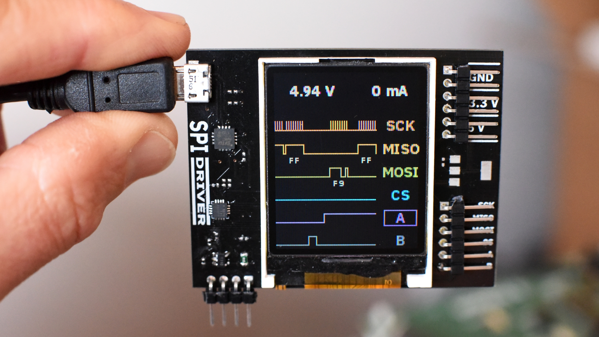

Full documentation is at
[spidriver.com](https://spidriver.com).

SPIDriver is a tool for controlling any SPI device from your PC's USB port.
It connects as a standard USB serial device, so there are no drivers to install.
The serial protocol is [very simple](/protocol.md),
and there are included drivers for

* Windows/Mac/Linux GUI
* Windows/Mac/Linux command-line
* Python 3.10+ (including SPIDriverQ support; see [Python driver](python/README.md))
* Windows/Mac/Linux C/C++

## Releasing

See [RELEASING.md](RELEASING.md) for instructions on publishing Python releases
to PyPI with Trusted Publishing and provenance.

## Contributed language bindings

The following bindings were contributed by SPIDriver community members:

* **.net** https://github.com/alandoherty/spidriver-net
* **rust** https://docs.rs/spidriver/0.1.0/spidriver/

[spidriver.com](https://spidriver.com)
